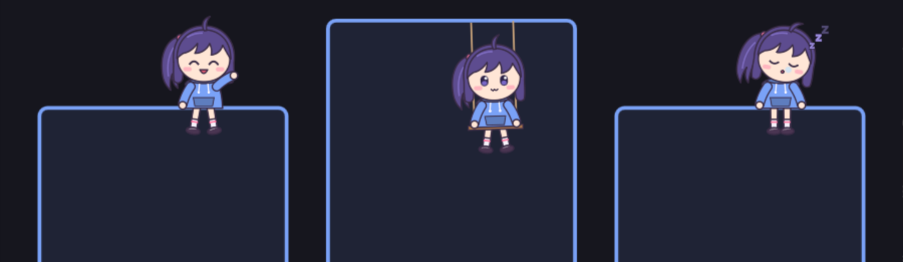

# Perch for Omarchy

Mochi, a tiny chibi friend who lives on your focused window in
[Omarchy](https://omarchy.org). She sits on the window's top-right corner and
swings her legs, chats in comic speech bubbles, waves when you switch windows,
and naps when you step away.



## Install

```bash
omarchy plugin add https://github.com/jebin2/omarchy-perch.git --enable
omarchy restart shell
```

She shows up on the focused window. Nothing else to set up.

## What she does

- **Sits on the focused window's top edge**, near its right corner. She
  swings her legs in little bursts, and her hair and ponytail sway along.
- **Swings from the window's top border** on windows that touch the bar (the
  usual tiled case). There is no room above those, so she hangs inside the
  corner on a little swing instead of covering the bar.
- **Travels** to the window you switch to, then waves: along a level edge
  she **walks** (runs if it's far; on her swing under the bar the swing
  slides along), and anywhere else on the screen she **jumps** there.
- **Talks** in puffy comic cloud bubbles that pop in, type out and float away; a yellow one that shakes when she shouts, little puffs when she thinks. She keeps one at a time: speech waits while her sign is up.
- **Yawns** a few seconds before she naps, then **naps** after 90 seconds
  without keyboard or mouse input: eyes closed, a sleep bubble and a few z's.
  While a video is playing (anything that keeps the screen awake) she stays
  up and watches with you. When you come back she **stretches** and says hi.
- **Falls off** when the window she sits on closes ("waah!"), and pops up on
  the next one.
- **Gets out of the way:** when the pointer rests on her for a moment, she
  scoots along the edge away from it, looking surprised, so you can click
  whatever was under her (a tab, a button, a bar icon). She drifts back to
  her corner a few seconds after the pointer has gone.
- **Likes a pat:** click her before she scoots and she smiles, and stays put
  for more.
- **Can be picked up:** drag her onto any window (or anywhere along an
  edge) and she sits there for 3 minutes, whichever window is focused, then
  goes back. **Double-click** her for a high five.
- **Holds up your reminders:** when an `omarchy reminder 30 "Pickup Jack"`
  goes off, she shows (or says) "Pickup Jack".
- **Keeps quiet in meetings:** while the mic or camera is in use, she says
  nothing (checked every 15 s; a quick dictation doesn't count).
- **Knows what's playing:** a new song in a music player goes on her sign
  ("♪ Song – Artist", at most every 2 minutes). Character packs can also
  tell when a video is playing (for popcorn).
- **Break reminder:** after an hour of activity she stretches and reminds
  you to take a break.
- **Lives on the desktop** of an empty workspace, if her character pack
  can stand and walk (`roams: true`): she runs in, strolls along the bottom
  of the screen and does her thing; open a window and she jumps up on it.
  Mochi just waits for the next window.
  Packs that can fly take a **broom** on long trips and for joyrides; packs
  that can climb prop a **ladder** against the bar, climb up and swing there
  a while.
- **Comes in** from off screen at login, when you unlock the screen, after
  the laptop wakes up, and when you're back after a long time away. Packs
  with a broom fly a loop in the middle of the screen and hover there to say
  hello, then fly to her place; others jump in.
- **Notices** things: covers her ears at 100% volume, says "shh" on mute,
  shades her eyes at full brightness, and points at new notifications (the
  app's name only; not during Do Not Disturb, a meeting or a focus timer).
- **Sticky notes** you add (`note "…"`, optional `at 6`, `at 18:30`, `in 20m`)
  stay pinned under the bar on the desktop; at that time she holds the note
  up. Click a note to take it down.
- **Hides** on fullscreen windows.
- Her hoodie follows your theme's accent color.

Her window is a transparent layer over the whole screen that never moves,
so all her motion is smooth. Only her body takes the pointer; everything
else, bubble included, lets clicks through.

## Bar icon

Perch adds a small kiwi icon to the bar. Click it for a panel to:

- show or hide her (or right-click the icon),
- turn her speech bubbles on or off,
- pick a character (Mochi, or your own packs; see [CHARACTERS.md](CHARACTERS.md)),
- change her size (50–200%),
- choose what she does **with windows open** and **on an empty workspace**
  (each its own set of switches, below),
- start a focus timer (25, 50 or 90 min): she stays put and quiet, shows a
  little countdown, and holds up a break sign at the end,
- see, add and take down sticky notes,
- make her wave, think, yawn, stretch, fall or fly (even with flying off),
  plus every move her character offers (Mochi's or your own pack's).

| Switch | With windows | Empty workspace |
|---|---|---|
| Getting to the next window | `winMove`: **`run`** (in any direction, up and down too; on her swing under the bar the swing slides), `jump` (every trip up or down; side to side when there's room above her), or `fly` (her broom for every trip, flat along the bar when there is no room above; she also flies in to say hello) | |
| Sky trips (a broom loop over the screen now and then) | `winSky`, **off** | part of `deskFly` |
| Clouds to sit on all over the screen (she flies or jumps up, sits a while, moves on) | | `deskClouds`, on |
| Fly on her broom | | `deskFly`, on |
| Come to the empty workspace | | `deskShow`, on |
| Weather and seasons (rain, snow, leaves, petals, fireflies, shooting stars) | | `deskAir`, on |
| Games (hide and seek, if her character has it) | | `deskGames`, on |
| Sticky notes pinned on the desktop | | `deskNotes`, on |

Her **Attitude** (`attitude`) applies everywhere: `sweet` (never sassy),
**`some`** (a little sass), `lots` (sassy half the time) or `diva` (sassy
most of the time), or `loop` (all four in turn, 15 minutes each; the panel
shows which one is on). Characters that know it also roll their eyes, flip their
hair and check their nails more the sassier she is.

She always reacts to volume and brightness changes, mute, screenshots and
notifications, and reminds you to take a break after an hour at the screen.
To turn those off, set `"winSenses": false` (on windows), `"deskSenses":
false` (empty workspace) or `"winBreaks": false` in the config file.

The panel saves to `~/.config/perch/config.json`, which you can also edit:

```json
{ "character": "mochi", "size": 0.9, "shown": true, "talk": true }
```

From a script or a key binding: `omarchy-shell jebin2.perch set size 1.2`
(also `character <name>`, `shown true|false`, `talk true|false`, and any
switch above, like `set winSky true` or `set winMove fly`), and
`omarchy-shell jebin2.perch toggle` to hide or show her.

### Screenshots: pose, or stay out

She notices Omarchy screenshots and poses afterwards. To have her pose *in*
the shot, or step out of it, bind your screenshot key to the `shot` command in
`~/.config/hypr/bindings.lua`:

```lua
o.rebind("PRINT", "Screenshot", [[sh -c 'd=$(omarchy-shell jebin2.perch shot 2>/dev/null); case "$d" in 0|0.*) ;; *) d=0 ;; esac; sleep "$d"; exec omarchy-capture-screenshot']])
```

The panel's **In screenshots** picks what she does: **Pose for them** (a
selfie pose, the shot waits 0.8 s for it) or **Stay out** (she's hidden for
the shot and back 2.5 s later).

## What she says

She has three moods, **serious** (gentle reminders), **fun** and **sassy**,
and mixes all three. She speaks up:

| When | For example |
|---|---|
| The first time she appears, or after a long nap | "good morning! ☀️", "…why are we still awake 🦉" |
| Now and then when you switch windows, about the app | terminal: "sudo make me a sandwich 🥪", browser: "that's like 40 tabs" |
| Every few minutes, something random | "posture check!", "I see you. 👀" |
| After an hour of activity | "an hour in. stand up and stretch?" |
| Battery at 15%, charger in or out | "I'm hungry… charger? 🔋", "nom nom ⚡" |
| Her window closed | "hey! I was sitting there" |
| A new theme | "new outfit! ✨" |

Ordinary lines keep at least 45 seconds apart; the events above skip the
wait. Apps are recognised by their window class only; window titles and
contents are never read.

### Your own lines

Her lines live in `lines.json` next to `Perch.qml`. To change them without
touching the plugin, create `~/.config/perch/lines.json` with any of the same
sections; each section you include replaces hers (for `app`, each app entry).
It reloads on save.

```json
{
  "chatter": {
    "fun": ["pizza later?"],
    "serious": ["one thing at a time"],
    "sassy": ["is that a bug I see?"]
  },
  "app": {
    "obsidian": ["writing again? nice"]
  }
}
```

A section is a list of lines (any mood) or lists keyed by `serious`, `fun`
and `sassy`. `app` keys are matched against the window class,
case-insensitively, as regular expressions. The sections are `app`, `time`
(`morning`, `noon`, `afternoon`, `evening`, `night`, `latenight`), `chatter`,
`battery_low`, `charging`, `unplugged`, `window_closed`, `theme`, `break`,
`wake` and `yawn`. Lines are at most 160 characters.

### Make her say or do something

```bash
omarchy-shell jebin2.perch say "build passed! 🎉"
omarchy-shell jebin2.perch sign "DON'T overthink"   # holds it up on a sign if her pack has one, else says it
omarchy-shell jebin2.perch act wave      # also: yawn, stretch, think, fall, fly, cloud
omarchy-shell jebin2.perch focus 25      # a focus timer, in minutes; `focus 0` stops it
omarchy-shell jebin2.perch note "call mom at 6"   # a sticky note on the desktop; she holds it up at 6
omarchy-shell jebin2.perch notes         # list them; `unnote 2` or `unnote all` takes them down
omarchy-shell jebin2.perch selfie        # she strikes a selfie pose (see below)
```

Other names (lowercase letters, digits, `-`, `_`) go to the character pack,
which can play its own move for them, e.g. `act cheer`. Mochi ignores them.

Handy at the end of a long script.

## Every line she says

All 213 lines from [`lines.json`](lines.json), by when she says them. A line
shown in all three columns is said in any mood. Her **Attitude** setting decides
how often she picks a sassy one. To change or add lines, see
[Your own lines](#your-own-lines).

### Greetings by time of day

The first time she appears, after a long nap, and sometimes as chatter.

| Time | Serious | Fun | Sassy |
|---|---|---|---|
| Morning (5–11) | morning! water first 💧 | good morning! ☀️<br>morning! ready to go? | up early… or still up late?<br>coffee first. talk later.<br>rise and… ugh, fine, shine |
| Noon (11–14) | eat something real, okay? | lunch time? 🍜 | I'd eat, if I could. you can.<br>lunch exists, you know<br>noon already? what did we even do |
| Afternoon (14–18) | afternoon slump? short walk! | afternoon snack? 🍪 | coffee number three, huh ☕<br>afternoon slump? I'm judging, gently<br>the 3 pm stare. I know it. |
| Evening (18–22) | wrap up soon? | evening already! 🌆 | overtime again?<br>still here? the evening called, it wants you back<br>logging off soon, right? RIGHT? |
| Night (22–2) | screens off soon, sleep is good | it's getting late… 🌙 | bedtime was a suggestion, I see<br>night owl or just stubborn?<br>the bed misses you. I don't. kidding. |
| Late night (2–5) | it's really late. go to bed. | …why are we still awake 🦉 | even the owls went home<br>it's late. even I'm tired of you<br>sleep is free, you know<br>go to bed. I'm serious. sort of. |

### About the app you switched to

Now and then (35% of the time) when you focus a window. Matched against the
window's class.

| App | Serious | Fun | Sassy |
|---|---|---|---|
| **Terminals**<br><sub>`foot`, `alacritty`, `kitty`, `ghostty`, `wezterm`, `konsole`, `terminal`</sub> | commit early, commit often<br>read it twice, run it once | sudo make me a sandwich 🥪<br>type faster, I'm watching 👀<br>ooh, green text time | rm -rf? not on my watch<br>another terminal? bold.<br>ah yes, the black window of mystery<br>typing like you know what you're doing 💅 |
| **Browsers**<br><sub>`brave`, `chrom`, `firefox`, `zen`, `librewolf`, `browser`</sub> | bookmark it, then close it<br>tabs eat memory, just saying | one more tab won't hurt<br>ooh, the internet! 🌐 | that's like 40 tabs<br>"research", sure 🙃<br>"just one tab" 🙄<br>research, sure. totally research.<br>close a tab. any tab. please. |
| **Editors and notes**<br><sub>`code`, `cursor`, `zed`, `nvim`, `neovim`, `jetbrains`, `idea`, `emacs`, `omawrite`, `typora`, `obsidian`</sub> | small steps, then test<br>good names save hours | ship it! 🚀<br>it works on my machine ✨ | bug or feature? 🐛<br>comments are nice, you know<br>it works on your machine, I'm sure<br>that bug? that's a feature now<br>commit message: "fix". iconic. |
| **Music and video**<br><sub>`spotify`, `mpv`, `vlc`, `celluloid`, `youtube`, `music`</sub> | volume check: protect those ears | ♪ la la la ♪<br>turn it up! 🎶 | your playlist, your rules… I guess<br>this song again? okay…<br>your playlist says a lot about you |
| **Chat**<br><sub>`discord`, `telegram`, `signal`, `slack`, `whatsapp`, `element`, `vesktop`</sub> | replying later is okay too | say hi from me! 👋 | gossip time? 👀<br>gossip time? spill 👀<br>they can wait. I can't. |
| **Games**<br><sub>`steam`, `lutris`, `heroic`, `wine`, `gamescope`, `igi`</sub> | one round, then a break? | game time!! let's go 🎮 | "just one more game"<br>"just one game". sure.<br>I've seen you play. good luck 😏 |
| **File managers**<br><sub>`nautilus`, `thunar`, `dolphin`, `files`</sub> | tidy files, tidy mind | so many folders… | lost something again?<br>lost something? shocking.<br>that Downloads folder is a crime scene |

### Events and chatter

| When | Serious | Fun | Sassy |
|---|---|---|---|
| Random chatter, every few minutes | posture check!<br>blink a few times, eyes need it<br>deep breath in… and out<br>drink some water 💧 | *hums*<br>I like this corner<br>swing, swing, swing~<br>do windows have feelings?<br>hehe | I could do this faster<br>are we working or what?<br>I see you. 👀<br>nice cursor work. I guess.<br>I'm not saying you're procrastinating… but you are 💅<br>that tab count is a cry for help<br>wow. riveting. 🙄<br>is this the plan, or…?<br>I'd help, but I'm busy being adorable<br>you call that a break? I call it a lifestyle<br>*checks nails* oh, you're still here<br>bold of you to ignore me |
| After an hour of activity | an hour in. stand up and stretch?<br>water break? 💧 | stretch with me! ~<br>wiggle your toes 🦶 | your chair can survive without you. stand up.<br>your chair misses you less than you think<br>up. walk. now. don't argue<br>break time, unless you're a robot |
| A focus session starts | focus · {min} min | focus mode · {min} min 🎧<br>{min} min. go go go! | {min} min. no tabs. I'm watching.<br>focus? you? okay, let's see<br>fine, I'll pretend I'm not here<br>phone down. I'm watching 👀 |
| A focus session ends | time's up. take 5. | done! break time 🌸<br>you did it! stretch 🙆 | timer's done. so are you. break.<br>look at you, being productive<br>done? I'm almost impressed<br>okay fine, that was good |
| Battery at 15% or less | battery's low, plug in soon | I'm hungry… charger? 🔋 | feed me or we both nap<br>charger. now. I'm not dying for this<br>running on vibes and 10%? brave |
| Charger plugged in | charging, thanks! | nom nom ⚡<br>yum, power! | finally, food<br>finally. was that so hard?<br>plugged in. you're welcome. |
| Charger unplugged | on battery now, go easy | off the leash! 🏃‍♀️ | living dangerously<br>oh, we're living dangerously now?<br>no charger? okay, adventurer |
| Her window closed (she falls off) | oof. found a new spot. | waah! 😵<br>whoops! | hey! I was sitting there<br>rude. I was MID-swing<br>you could've warned me 🙄<br>and you didn't even say bye |
| New theme | fresh look! | new outfit! ✨<br>ooh, I like this color | do I look good? I look good.<br>hmm… we'll see about this one<br>new look. same you.<br>I liked the last one better. just saying |
| Back after a nap | welcome back | oh! you're back 👋<br>*stretches* hi again | took you long enough<br>oh, NOW you're back<br>I wasn't waiting. at all. |
| Yawning before a nap | *yaaawn*<br>*yawn*… so sleepy | *yaaawn*<br>*yawn*… so sleepy | *yaaawn*<br>*yawn*… so sleepy |
| A notification (`{app}` is the app) | {app} wants you. | 📩 {app}!<br>ooh, {app} 👀 | {app} again?<br>{app} again? they're obsessed with you<br>ignore {app}. I'm more interesting<br>{app}, {app}, {app}… 🙄 |
| Volume up | volume up. | turn it up! 🎵<br>ooh, I like this one 🎶 | louder? bold.<br>okay DJ, calm down<br>louder? bold choice |
| Volume down | volume down. | shh, a bit quieter 🤫 | thank you.<br>thank you. my ears say thanks<br>quieter. smart. |
| Volume at 100% | that's very loud. careful with your ears. | my ears!! 🙉<br>LOUD. love it. ow. | are we deaf now?<br>are you deaf or is it a banger?<br>my ears! have some mercy |
| Muted | muted. | shhh 🤫 | finally, silence.<br>silence. finally.<br>shh yourself |
| Brighter screen | brighter. | sunshine! ☀️ | I can see everything now.<br>blinding me, I see<br>brighter? you're glowing, I'm squinting |
| Dimmer screen | dimmer. easy on the eyes. | cozy mode 😴 | mood lighting?<br>moody lighting. I like it.<br>dim? hiding something? |
| Full brightness | full brightness. easy on the eyes. | so bright! 😎<br>my eyes ☀ | is that the sun?<br>sunglasses, obviously 😎<br>I can see your soul at this brightness |
| A screenshot | screenshot taken. | cheese! 📸<br>did you get my good side? ✌️ | was I in it?<br>obviously my good side 💅<br>tag me 📸<br>you're welcome for the cameo |

## How it works

Perch is a background (`service`) plugin with a bar icon (`bar-widget`). It draws Mochi in a small,
transparent layer window and moves it to the focused window.

- **Where the window is:** Hyprland sends no events while a window is dragged
  or resized, so Perch asks Hyprland's socket for the focused window
  (`j/activewindow`) every 150 ms while she is awake. It stops while she
  sleeps.
- **Idle:** the Wayland idle notification (the same one Omarchy's screensaver
  uses). Perch never reads your keyboard.
- **Drawing:** she is made of separate vector pieces (legs, arms, face,
  ponytail, the one hair that never stays down), each drawn once into a
  texture and then moved in code. No images, no Live2D.
- **Cost:** each redraw costs the shell about a millisecond, so she updates
  25 times a second while swinging her legs and 10 while calm or asleep. On
  average that's about 6% of one CPU core while she is awake (measured on a
  laptop iGPU), less on battery, where she sits still for longer between
  bursts.
- Turning animations off (`omarchy toggle animations`) freezes her in place.

## Tuning

The numbers at the top of `Perch.qml`:

| Setting | Default | What |
|---|---|---|
| `inset` | `26` | Gap between her and the window's right edge, px |
| `sleepAfter` | `90` | Seconds without input before she naps |
| `pollMs` | `150` | How often the focused window's position is checked while she is awake |
| `moods` | all three | Which moods she picks lines from |
| `quietGapSec` | `45` | Least time between ordinary lines |
| `chatterEverySec` | `360` | About how often she says something random |
| `appChance` | `0.35` | Chance of an app line when you switch windows |
| `breakAfterMin` | `60` | Minutes of activity before a break reminder |

Background plugins don't hot-reload: run `omarchy restart shell` after an
edit.

## Uninstall

```bash
omarchy plugin remove jebin2.perch
omarchy restart shell
```

## License

MIT. Mochi is an original character, drawn for this plugin.

Speech balloons use [Comic Neue](https://github.com/crozynski/comicneue)
(SIL Open Font License 1.1, see [`fonts/OFL.txt`](fonts/OFL.txt)).
